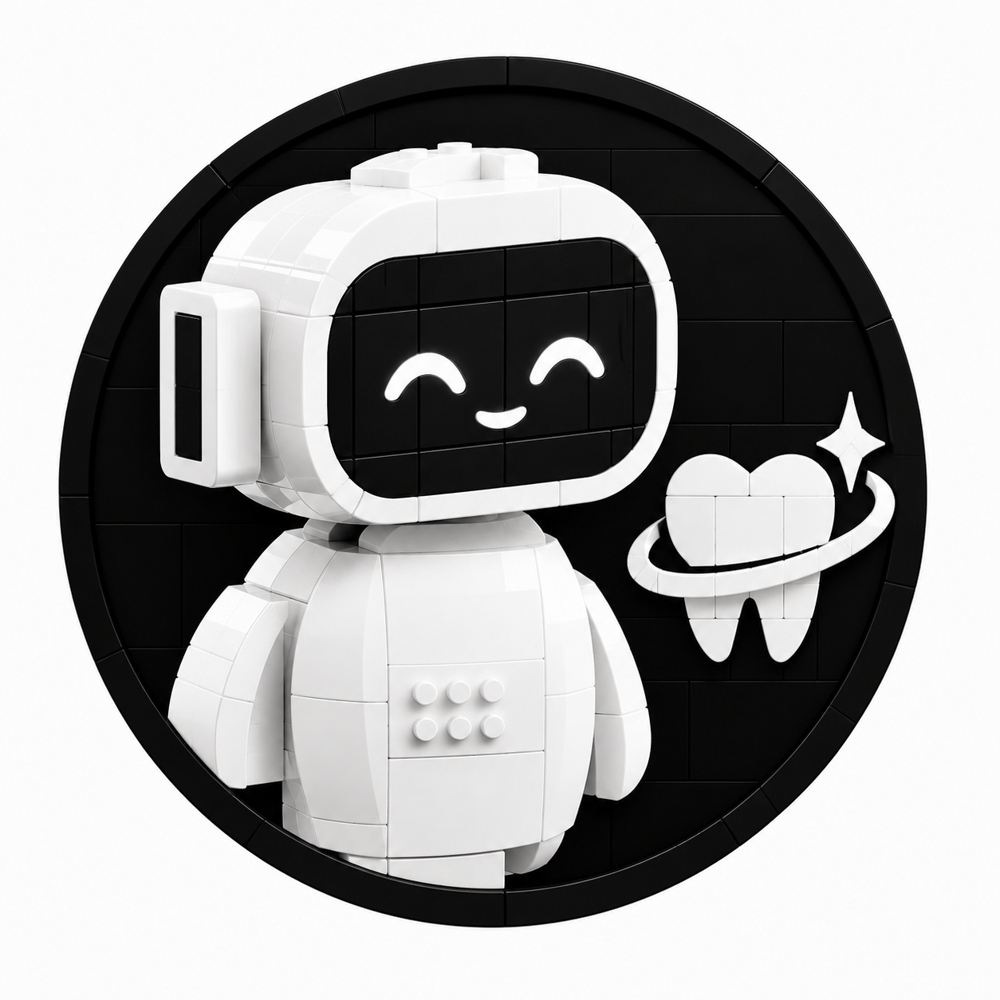

Persian assistant for a dental clinic. Ask a question and get a JSON answer. The same server can read the answer aloud and turn a voice file back into text.

The service binds `0.0.0.0:7860`. On this machine use `http://127.0.0.1:7860`. From another computer on the LAN, use this machine’s address, for example `http://192.168.7.187:7860`. `127.0.0.1` on the other computer is that other computer, not this one.

Interactive docs: `http://127.0.0.1:7860/docs`

## Ask a question

```bash
curl -s http://127.0.0.1:7860/ask \
  -H 'Content-Type: application/json' \
  -d '{"question":"هزینه روکش چقدره؟"}'
```

`/ask` checks the question in this order:

1. **Market price** — dollar, tether, gold, coin, or listed FX. The price is scraped from [ecotrust.ir](https://ecotrust.ir/). A toman figure is also given in rial (×10). There is no web search.
2. **Weather** — a city forecast from `agent/weather_mcp`. No email is sent.
3. **Clinic FAQ** — the path below. Anything that is not a price or weather question goes here.

```
question
  → Jina embed (jina-embeddings-v5-text-small)
  → Qdrant top 10 in collection clinic2_faq_qa
  → BGE reranker (bge-reranker-v2-m3)
  → refuse, or local LLM rewrite of the matched FAQ card
```

A match is kept when the combined score is at least `0.55`, the rerank score is at least `0.25`, and the Qdrant score is at least `0.30`. Otherwise the answer is a short Persian refusal. Set `"skip_llm": true` to return the stored FAQ text with no LLM call.

The LLM is an OpenAI-compatible server on `http://127.0.0.1:8080/v1`. The client asks for model id `Qwen3.8-27B`. Keep that alias on the server even if the GGUF file has another name.

### How to read the JSON

| Field | Meaning |
| --- | --- |
| `answer` | Text to show the user. For an FAQ hit this is the LLM rewrite. With `skip_llm` it is the stored FAQ text. |
| `faq_answer` | Stored FAQ card, truncated. Often the same words as `answer` when the LLM is skipped or when it stays close to the card. |
| `matched_question` | The FAQ question that was retrieved. It is not a copy of what you typed. |
| `card_id` | FAQ card id, such as `clinic2_1`. |
| `source` | `faq`, `weather_mcp`, or `ecotrust`. |
| `refused` | `true` when no FAQ card cleared the score gates. |
| `qdrant_score`, `rerank_score`, `score` | Retrieval scores. Tool answers use `score` `1.0`. |

`infrence.py` posts one sample question and writes the full JSON to `answer.json` (that file is gitignored).

## Speech

Speak Persian text. The WAV is PCM 16-bit so a browser can play it. Long text is split into sentence chunks and joined with a short pause.

```bash
curl -s http://127.0.0.1:7860/speak \
  -H 'Content-Type: application/json' \
  -d '{"text":"سلام. هزینه روکش بعد از معاینه مشخص می‌شود."}' \
  -D - -o reply.wav
```

The header `X-Voice-Url` looks like `/voices/20261014-104536-f29f.wav`. Open that path in a browser. Each call gets a new name. `GET /voice` plays the latest clip. `GET /` is a small page with a text box and a play button.

Transcribe a voice file with [Vosk](https://github.com/alphacep/vosk-api) Farsi model `vosk-model-fa-0.42` (CPU). Send multipart field `file`:

```bash
curl -s -F "file=@speech.wav" http://127.0.0.1:7860/asr
```

```json
{"text":"..."}
```

Health:

```bash
curl -s http://127.0.0.1:7860/health
```

```json
{"status":"ok","embed_device":"cuda","use_reranker":true,"collection":"clinic2_faq_qa","llm":"Qwen3.8-27B"}
```

## Run

You need Docker, Python 3.12, and a CUDA GPU for embeddings, rerank, and speech. FAQ answers that call the LLM also need something listening on port 8080. Weights are not in this repository.

```bash
cd rag
python3 -m venv .venv
source .venv/bin/activate
pip install -r requirements.txt

./scripts/start_stack.sh
```

That starts Qdrant (`qdrant-tita` on port 6333) and the API. The API log is `rag/logs/fastapi_faq.log`.

Start the LLM as well, if `../scripts/qwen_llama_start.sh` exists on the machine:

```bash
START_LLM=1 ./scripts/start_stack.sh
```

Stop the API and the LLM:

```bash
./scripts/stop_stack.sh
```

Qdrant keeps running. `STOP_QDRANT=1 ./scripts/stop_stack.sh` stops it too.

Put one FAQ file into Qdrant (the container must already be up):

```bash
./scripts/ingest_faq.sh restorative
./scripts/ingest_faq.sh "FAQ-General Anesthesia"
```

Sources live in `faqs/sources/` (`endo`, `clinic2`, `anesthesia`, `implant`, and the other specialty files). A source is a numbered list: many questions, one shared answer. Each question becomes its own vector. The answer is stored on every one of those points.

Measure retrieval and answer quality:

```bash
./scripts/run_all_evals.sh
```

Reports land in `rag/data/eval/`. If the embedder and the LLM do not fit on the GPU together:

```bash
EMBED_DEVICE=cpu ./scripts/run_all_evals.sh
```

## Layout

```
faqs/sources/          FAQ text and HTML
faqs/eval/  faqs/test/ question sets for eval
rag/scripts/           ingest, eval, FastAPI, TTS, ASR
rag/data/              parsed cards and eval reports (not the Qdrant index)
agent/weather_mcp/     weather tool used by /ask
agent/ecotrust_prices/ ecotrust.ir scraper used by /ask
infrence.py            sample /ask client
```

`rag/qdrant_storage/` is the live vector index and is not committed. Generated WAVs under `rag/data/voices/` are not committed either.

## Weights to download

| Piece | Put it here |
| --- | --- |
| [jinaai/jina-embeddings-v5-text-small](https://huggingface.co/jinaai/jina-embeddings-v5-text-small) | Hugging Face cache. `start_stack.sh` sets `HF_HOME` to `rag/.hf_cache`. |
| [BAAI/bge-reranker-v2-m3](https://huggingface.co/BAAI/bge-reranker-v2-m3) | same cache |
| [ResembleAI/chatterbox](https://huggingface.co/ResembleAI/chatterbox) | path in `CHATTERBOX_CKPT` |
| [Thomcles/Chatterbox-TTS-Persian-Farsi](https://huggingface.co/Thomcles/Chatterbox-TTS-Persian-Farsi) file `t3_fa.safetensors` | `T3_FA_WEIGHTS`, default `tita-arshia/t3_fa.safetensors` |
| [vosk-model-fa-0.42](https://alphacephei.com/vosk/models/vosk-model-fa-0.42.zip) | unzip, then place the folder at `rag/models/vosk-fa` (CPU). Or set `VOSK_MODEL` to that folder. |
| GGUF for the FAQ rewriter | outside this repo, served on port 8080 as model id `Qwen3.8-27B` |

```bash
# Farsi Vosk model (~1.6 GB)
mkdir -p rag/models
wget -O /tmp/vosk-model-fa-0.42.zip \
  https://alphacephei.com/vosk/models/vosk-model-fa-0.42.zip
unzip /tmp/vosk-model-fa-0.42.zip -d rag/models
mv rag/models/vosk-model-fa-0.42 rag/models/vosk-fa
```

Useful environment variables: `API_PORT`, `EMBED_DEVICE` (`cuda` or `cpu`), `USE_RERANKER`, `LLM_BASE_URL`, `LLM_MODEL`, `QDRANT_URL`, `SCORE_MIN`, `RERANK_MIN`, `QDRANT_FLOOR`, `TTS_DEVICE`, `VOSK_MODEL`.
